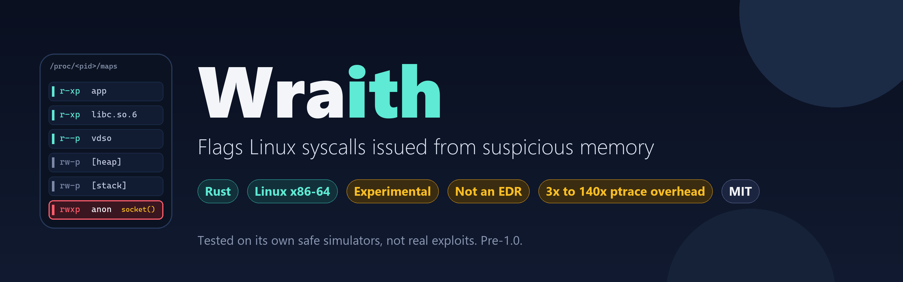
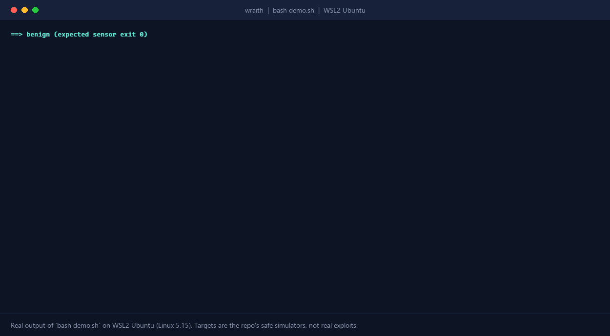
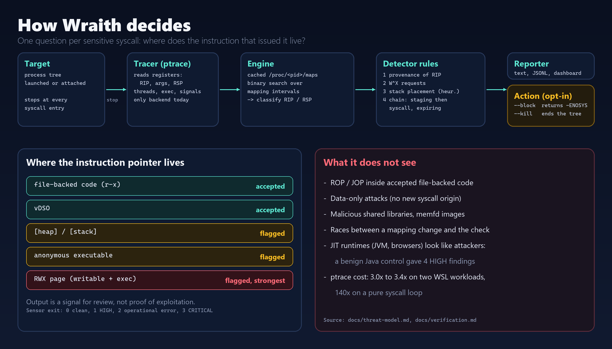

> ⭐ **GitHub: [github.com/grloper/Wraith](https://github.com/grloper/Wraith)** · open source (MIT) · by [@grloper](https://github.com/grloper)





Most runtime detection looks at what code is: a signature, a hash, a byte pattern. Attackers can change all of that. What they cannot avoid is that the code has to run from somewhere, and when it makes a system call, the instruction doing it sits at a particular address in a particular memory mapping. Wraith is an experimental Rust sensor that checks that one thing. I am releasing it as open source, and I want to be clear from the start that it is pre-1.0, has been tested against its own simulators rather than real exploits, and is not an EDR.



*Real output of `bash demo.sh`, which I ran on WSL2 Ubuntu (Linux 5.15) for this post; the GIF replays the captured text line by line. Twenty per-thread log lines from one benign case are trimmed in the GIF only. The "injection" is a safe simulator that maps an RWX page and opens a socket from it. No real exploit is involved.*

### The idea

On Linux x86-64, Wraith uses `ptrace` to stop a target at each syscall entry, reads the registers, and consults a cached copy of `/proc/<pid>/maps`. It then checks three invariants that ordinary programs normally satisfy:

1. **Provenance.** The instruction issuing a sensitive syscall should sit in an accepted executable mapping, meaning file-backed code or the vDSO. If it comes from RWX memory, the heap, the stack or an anonymous mapping, that is flagged.
2. **W^X.** Requests for writable and executable memory, and writable-to-executable transitions, are reported.
3. **Stack placement.** A stack pointer in the heap or a file mapping is a heuristic HIGH.

A violation is a signal for review, not proof of exploitation. It needs no payload signature, but it also does not know the vulnerability, so it only sees exploitation that leaves one of these artifacts.



### What it can show today

The repo ships safe local simulators, not exploits. `shellcode-sim` maps an RWX page, copies a tiny payload into it and runs it; the payload opens a socket. `bash demo.sh` runs six cases and asserts the outcomes:

- a benign program: no detections, exit 0 (80 syscalls, 0 events)
- a benign multi-threaded program: no detections across worker threads
- the shellcode simulator: a HIGH `wx_violation` for the RWX `mmap`, then a CRITICAL `foreign_origin_syscall` for `socket` issued from that page, then a CRITICAL `exploitation_chain`; sensor exit 3
- the same on a worker thread, exit 3
- with `--block`, the syscall returns `-ENOSYS` (the simulator prints `socket() -> -38`) and the fixture survives
- with `--kill`, the traced tree is terminated before the payload syscall runs

The script ends with `PASS: both controls clean; main/worker injection detected; block and kill verified.` That is the extent of the detection evidence. I have not run it against a real CVE exploit or real malware, and no false-positive rate has been established.

### What went wrong while building it

This is the useful part. The first real Java control completed successfully, but two handled SIGSEGV delivery stops were reported as HIGH crash events, because the JVM uses signals internally. The fix was to treat signal delivery as INFO and require a confirmed terminal status before calling something a crash. JVMs also request RWX pages, and the benign Java control still produced four HIGH findings for those RWX requests. Legitimate JITs look like attackers to this check, which is why the README says to baseline first and never to turn on `--jit-critical` or enforcement blindly.

Another bug: the kill path raced with queued stops while targets died, and a test using 64 alternating single-thread and worker-thread targets failed with ESRCH at iteration 5 before the fix. The repo keeps the failing-then-passing evidence in `docs/verification.md`.

### How it is built

An engine module owns policy, map lookup and statistics; a tracer module owns ptrace and enforcement. Provenance lookup is a binary search over parsed mapping intervals. Worker threads share per-address-space state. There are two direct dependencies, `nix` and `libc`, and no async runtime or serialization crate. Output is human-readable on stderr plus JSONL evidence, with schema versions, and a strict triage helper validates complete logs.

For this post I built the repo at its current `main` and ran the whole Rust suite in WSL2 with `WRAITH_REQUIRE_PTRACE=1`, so skipped ptrace tests would fail instead of passing quietly: 134 tests passed, 0 failed. (The README and `docs/verification.md` still say 130; the docs have not caught up with a few newer tests.)

### Quickstart

Linux 5.3+ on x86-64, Rust 1.74+, procfs mounted, and permission to trace your own child. WSL2 works; restricted containers may deny ptrace. Windows and macOS are not supported.

```bash
git clone https://github.com/grloper/Wraith.git && cd Wraith
cargo build --release --locked
./target/release/wraith doctor
bash demo.sh
./target/release/wraith run --json events.jsonl -- ./your-target
```

Sensor exit codes: 0 no HIGH/CRITICAL, 1 HIGH, 2 operational error, 3 CRITICAL. That is the sensor's status, not the target's.

### Honest limits

- **Blind spots:** ROP/JOP entirely inside accepted file-backed code, data-only attacks, malicious shared libraries, memfd-backed executable images and map races. The threat model lists them.
- **Overhead:** every traced syscall stops the target. On two WSL workloads the median slowdown was 3.36x (loopback HTTP, 20 requests) and 3.00x (SQLite, 200 transactions); a syscall-only loop was 140x. Use it on a few high-value targets, not a whole host.
- **JIT runtimes** (JVM, browsers, .NET) will produce findings. Baseline first.
- **Environment:** all measurements, mine and the repo's, come from WSL2, not native Linux. No fleet compatibility claim. An eBPF backend is not implemented.
- **Enforcement** can break legitimate applications and is not a substitute for a sandbox.
- **A clean result** means no configured signal was observed, not that an exploit is absent.

### Try it, and help

The most useful contributions are a benign program that trips it, a regression fixture for it, or timing numbers from a real service on native Linux. Start with `CONTRIBUTING.md` and `docs/roadmap.md` at [github.com/grloper/Wraith](https://github.com/grloper/Wraith). Please report security issues through `SECURITY.md`.
